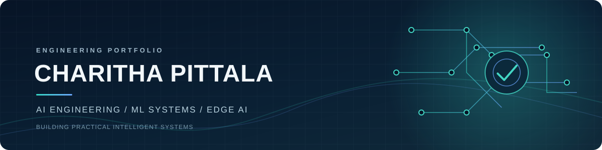

  

  <a href="https://charitha6969.github.io/charithapittala.github.io">Portfolio website</a> ·
  <a href="https://github.com/CHARITHA6969">GitHub</a> ·
  <a href="mailto:charitha696969@gmail.com">Email</a>

I build practical AI software across **LLM applications, machine learning systems, backend engineering, and Edge AI**. I’m interested in taking intelligent systems from prototypes to reliable products—with measurable performance, useful interfaces, and clear engineering trade-offs.

## Current work

| Project | What it does | Core technologies |
|---|---|---|
| [**GradeFlow**](https://github.com/CHARITHA6969/gradeflow) | Full-stack assessment workflow with instructor/student roles, assignment publishing, and persistent submissions | React · Python · FastAPI · SQLAlchemy · PostgreSQL |
| [**Neurotrial**](https://github.com/CHARITHA6969/neurotrial) | Research-document ingestion, source retrieval, and citation-oriented clinical-trial analysis | React · FastAPI · Python · LLMs · SQLAlchemy |
| **Vision-Based Retail Shrink Prevention** | Edge perception and sensor-fusion architecture for retail operations | Computer Vision · Edge AI · TensorRT · OpenVINO · RFID · POS |
| **Enterprise Claims QA** | Retrieval-grounded question answering over claims documents | Python · RAG · FAISS · Pinecone · Azure ML |
| **ML Inference Optimization** | Model/runtime optimization and performance-focused serving | PyTorch · TensorRT · OpenVINO · Quantization · Kubernetes |

## Focus areas

- **AI & retrieval:** LLM applications, RAG, document intelligence, embeddings, source citations, evaluation.
- **ML systems:** PyTorch, TensorFlow, model optimization, quantization, inference profiling and serving.
- **Edge AI:** Real-time computer vision, object detection, tracking, sensor fusion, event-driven edge-to-cloud systems.
- **Backend engineering:** Python, FastAPI, REST APIs, PostgreSQL, SQLAlchemy, asynchronous workflows.
- **Cloud & delivery:** AWS, Azure, Docker, Kubernetes, Terraform, CI/CD.

## Selected engineering work

### Edge AI · Vision-Based Retail Shrink Prevention

Designing an edge-based perception architecture that processes RGB/depth camera streams close to their source, detects product and activity events, and correlates visual information with shelf/weight sensors, RFID, POS, and entry/exit signals.

The design emphasizes low-latency inference, hardware-aware model optimization, timestamp-aligned sensor fusion, false-positive measurement, privacy-aware event processing, and human-reviewed alerts.

*Status: architecture/project concept—not a deployed or field-validated retail system.*

### GradeFlow · Full-stack product engineering

A React + FastAPI application with signed instructor/student sessions, role-protected assignment APIs, assignment publishing, and persistent text submissions. SQLAlchemy models and Alembic migrations provide the database foundation. Frontend and backend CI workflows exercise the implemented paths.

### Neurotrial · Document intelligence

A React + FastAPI research prototype with PDF/TXT/Markdown ingestion, persistent document chunks, lexical retrieval, and source/chunk citation metadata. Anthropic credentials are held server-side. The current retrieval baseline is lexical; embedding-based retrieval and reranking are future work.

## Engineering approach

I value small, verifiable increments; readable APIs; tests and automation; documented assumptions; responsible use of AI; and performance claims backed by reproducible measurements.

## Connect

[GitHub · @CHARITHA6969](https://github.com/CHARITHA6969) · [charitha696969@gmail.com](mailto:charitha696969@gmail.com)

  Building useful AI systems with sound engineering and measurable outcomes.

