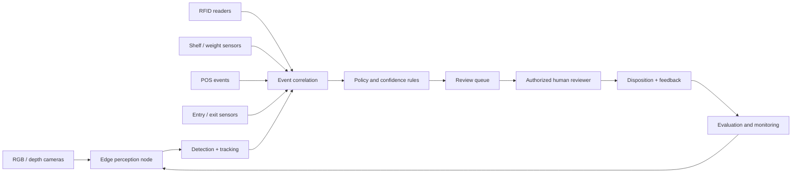

# Vision-Based Retail Shrink Prevention

Architecture case study · Edge AI · Computer Vision · Sensor Fusion

> **Project status:** Architecture concept and design exercise. This repository does not contain a deployed retail product, field-validated model, or production integration with a retailer.

## Problem framing

Retail loss-prevention teams may need to review large volumes of store activity while reconciling signals from cameras, point-of-sale systems, RFID, shelf sensors, and store operations. A useful system should reduce the time required to identify potentially relevant incidents without treating a model prediction as proof of wrongdoing.

The proposed system is an **event-triage platform**: it correlates low-level signals, produces reviewable evidence packages, and routes uncertain events to authorized human reviewers.

## Design goals

- Process video close to the source where practical, reducing unnecessary transmission of raw footage.
- Detect and track relevant objects or activities with a measurable latency budget.
- Correlate camera observations with non-video signals using event timestamps.
- Preserve source references and model metadata so an alert can be reviewed.
- Optimize for precision and manageable review volume, not only raw detection recall.
- Avoid automated accusations, employee/customer scoring, or punitive decisions.

## High-level architecture

## Event-processing flow

1. **Capture:** A camera stream is processed by an edge node. Raw video retention and transfer are governed by store policy.
2. **Perception:** A detector and tracker emit time-bounded observations with class, track identifier, confidence, and device timestamp.
3. **Signal ingestion:** RFID, POS, shelf-weight, and entry/exit systems publish their own timestamped events.
4. **Time alignment:** Events are normalized to a common event schema. Clock drift and source uncertainty are recorded rather than silently ignored.
5. **Correlation:** Rules or a lightweight event model associate observations that occur within defined time and spatial windows.
6. **Triage:** A candidate incident is assigned a review priority with the contributing signals and confidence metadata.
7. **Human review:** An authorized reviewer sees the evidence and decides whether an operational follow-up is appropriate.
8. **Feedback:** Reviewer outcomes feed monitored evaluation datasets after privacy, retention, and access checks.

## Proposed event contract

An event envelope should be versioned and traceable:

| Field | Purpose |
|---|---|
| `event_id` | Stable identifier for deduplication and audit references |
| `event_type` | Detection, track update, POS event, RFID read, weight change, or correlated incident |
| `occurred_at` | Source event timestamp in UTC |
| `ingested_at` | Platform receipt timestamp in UTC |
| `store_zone` | Coarse operational zone, not a person's identity |
| `source_id` | Camera, sensor, or system identifier |
| `model_version` | Model/runtime version for perception-generated events |
| `confidence` | Calibrated confidence when applicable |
| `evidence_refs` | Access-controlled references to relevant snippets or sensor records |
| `correlation_id` | Links events belonging to one reviewable incident |

The envelope should not carry names, facial identity templates, payment-card data, or other direct personal identifiers.

## Model and runtime strategy

The edge node may run a compact detector/tracker selected for the target hardware. Candidate runtimes include ONNX Runtime, OpenVINO, or TensorRT, depending on hardware compatibility and measured performance.

Model selection must be based on a representative validation set and hardware benchmark—not on a framework name alone. Quantization, batching, and input-resolution changes should be evaluated for their effect on both latency and error rates.

## Evaluation plan

The system should be evaluated at multiple levels.

| Layer | Metrics |
|---|---|
| Object detection | Precision, recall, per-class AP, calibration |
| Tracking | ID switches, track fragmentation, continuity |
| Sensor correlation | Event precision/recall, timestamp alignment error |
| Triage queue | Review volume, precision at top-k, false-alert rate |
| Operations | P50/P95 latency, dropped events, uptime, storage and bandwidth |
| Human workflow | Reviewer agreement, override rate, time to disposition |

Evaluation data should include normal operations, edge cases, different store layouts, lighting changes, occlusions, sensor failures, and known data gaps. Performance should be reported by scenario, not only as one aggregate score.

## Privacy, safety, and governance

- Do not use face recognition or identity inference as a feature of this design.
- Prefer on-device feature extraction and short-lived volatile buffers where policy allows.
- Encrypt data in transit and at rest; apply role-based access and auditable evidence access.
- Establish explicit retention limits and deletion workflows for video and derived event data.
- Do not create person-level risk scores or automated theft determinations.
- Require human review before any operational or employment action.
- Evaluate false positives and disparate error patterns across store conditions and relevant populations.
- Conduct privacy, legal, security, and workforce review before any pilot.

## Failure modes to design for

- Sensor clocks drift or timestamps arrive out of order.
- A camera is blocked, moved, or disconnected.
- RFID reads are duplicated or missed.
- POS data arrives late or has an incorrect transaction association.
- Edge devices lose network connectivity.
- Model confidence is miscalibrated under unfamiliar lighting or store layouts.
- A correlated signal is incorrectly interpreted as intent.

Every event should preserve provenance and uncertainty. Missing sensor evidence must not be interpreted as evidence of misconduct.

## Delivery phases

1. **Offline design validation:** define event schema, synthetic scenarios, threat model, privacy model, and acceptance criteria.
2. **Recorded-data prototype:** evaluate perception and sensor correlation on approved, de-identified or consented sample data.
3. **Shadow-mode pilot:** generate review suggestions without changing existing loss-prevention decisions.
4. **Human-reviewed pilot:** evaluate alert quality, workload, reviewer agreement, and operational failure handling.
5. **Controlled expansion:** proceed only after independent privacy, security, legal, and performance review.

## Current status and next implementation step

This is an architecture case study, not a completed product. The next meaningful implementation slice would be a small event-correlation service with a versioned event schema, deterministic time-window rules, synthetic fixtures, and tests for duplicate, delayed, and missing sensor events.

That slice would make the design executable without requiring access to retail cameras or real customer data.
